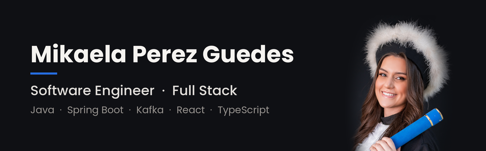

### Oi, eu sou a Mikaela.

Sou engenheira de software full stack em Porto Alegre, com mais de 3 anos construindo aplicações corporativas de alta disponibilidade, boa parte delas no ecossistema financeiro.

Trabalho no ciclo completo, do refinamento à produção, em sistemas com alto volume de transações. No dia a dia isso envolve microsserviços em Java e Spring Boot, mensageria com Kafka e RabbitMQ, interfaces em React e TypeScript, testes automatizados e observabilidade para saber o que está acontecendo em produção antes que o usuário perceba.

Gosto de código que outra pessoa consiga ler e manter. Uso Clean Code e SOLID, registro as decisões técnicas importantes e prefiro resolver problemas junto com o time.

Hoje faço pós-graduação em Arquitetura de Software na FIAP, estudando resiliência, escalabilidade e desenho de sistemas distribuídos.

### Com o que eu trabalho

- **Back-end:** Java, Spring Boot, Quarkus, Node.js, JPA/Hibernate, bancos relacionais
- **Front-end:** React, TypeScript
- **Arquitetura e integração:** microsserviços, APIs REST, Kafka, RabbitMQ
- **Qualidade e operação:** testes unitários e de integração, observabilidade, Docker

### Projetos paralelos

A maior parte do que eu construo fica no código das empresas. Aqui ficam os projetos que faço por fora, para estudar ou para ajudar alguém.

**[Zildo Tornearia](https://github.com/mikaelapg/zildo-tornearia-site)**
Site para a oficina de família de uma amiga, em Alvorada/RS. Feito sem framework, com pedido de orçamento direto no WhatsApp, validação automática do HTML a cada push e pensado para ser fácil de manter por quem não é da área.

### Contato

[LinkedIn](https://www.linkedin.com/in/mikaela-perez-guedes) · Hablo español con fluidez.
