### Hoje

Sou engenheira de software full stack com mais de 3 anos construindo aplicações de alta disponibilidade, a maior parte no ecossistema financeiro. Trabalho do refinamento à produção em sistemas com alto volume de transações: microsserviços em Java e Spring Boot, mensageria com Kafka e RabbitMQ, front em React e TypeScript, testes automatizados e observabilidade.

Gosto de código que outra pessoa consiga ler e manter, registro as decisões técnicas que importam e prefiro resolver problemas junto com o time.

### Estudando agora

Pós-graduação em Arquitetura de Software na FIAP: resiliência, escalabilidade e sistemas distribuídos.

### Contato

[LinkedIn](https://www.linkedin.com/in/mikaela-perez-guedes) · Respondo em português ou en español.
